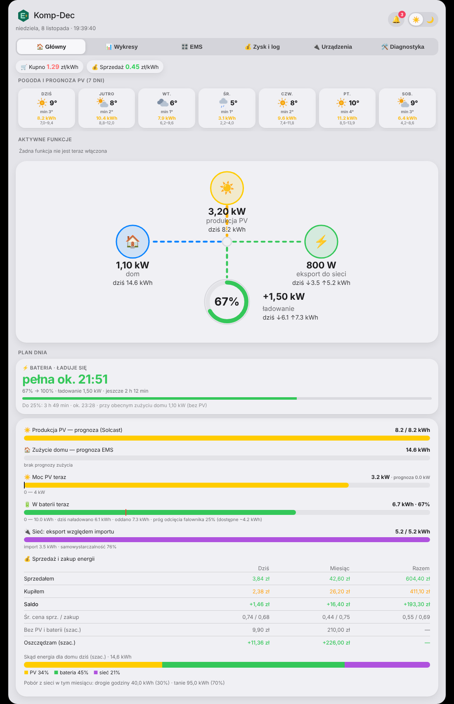
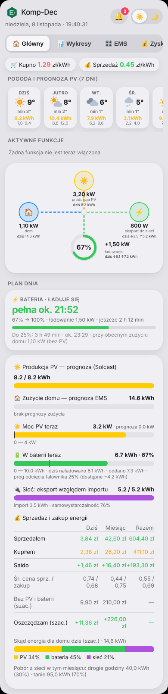
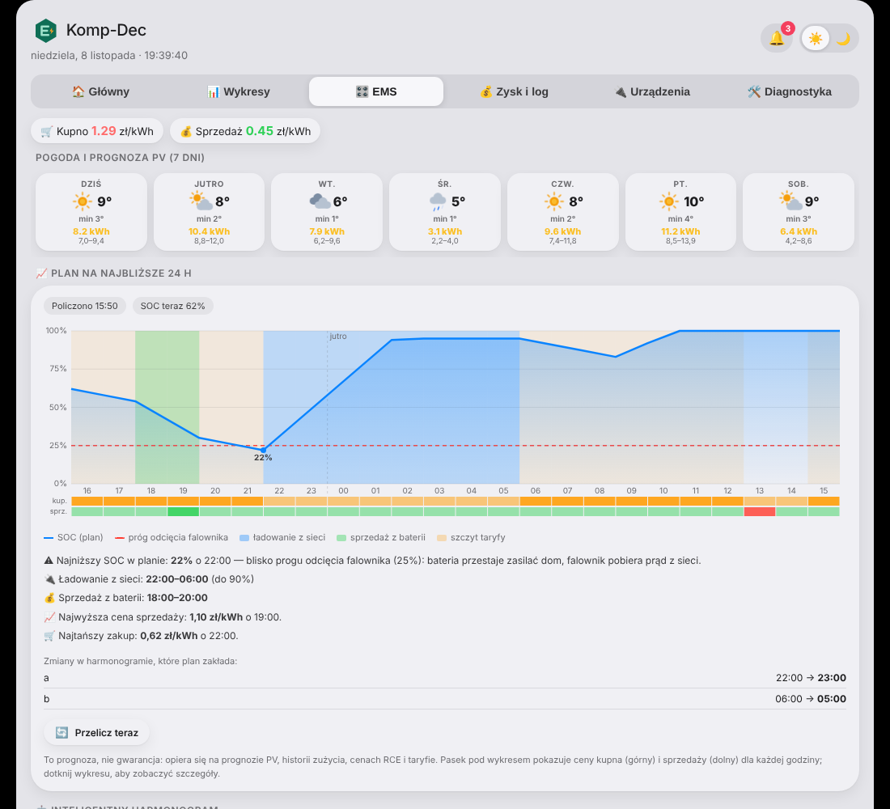
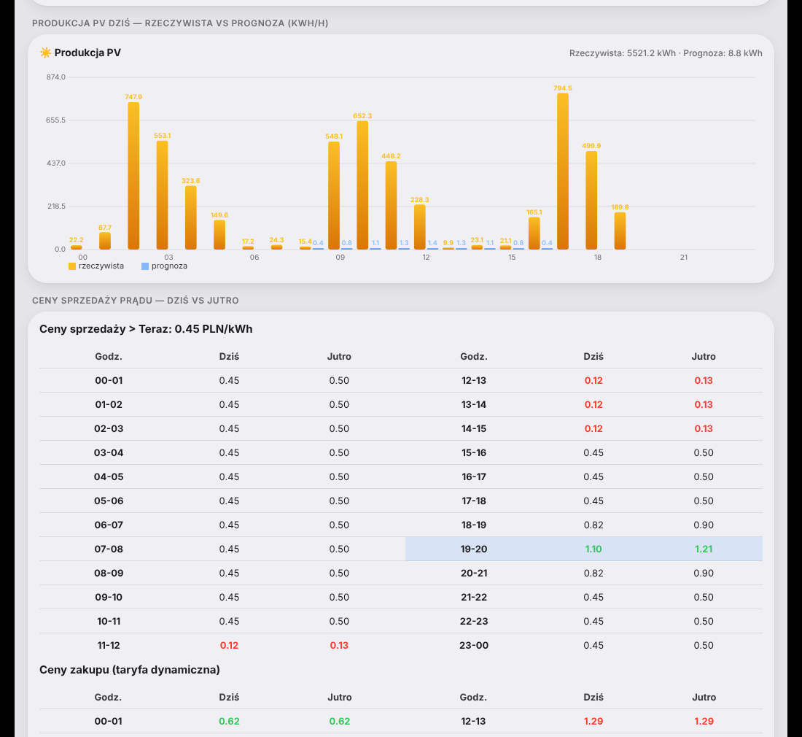
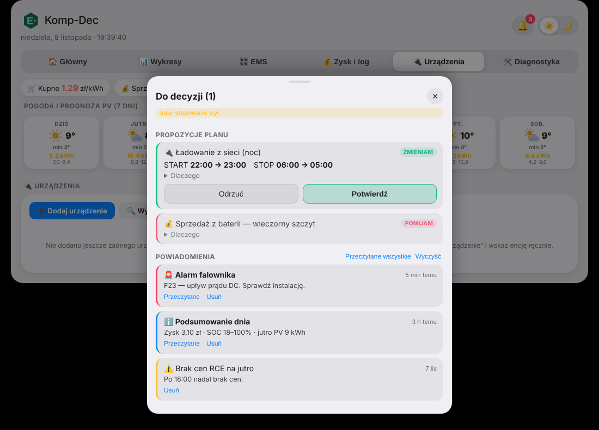
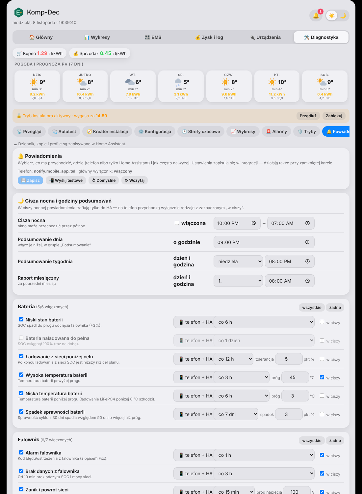
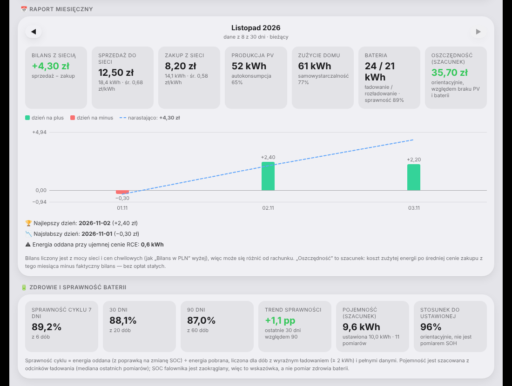
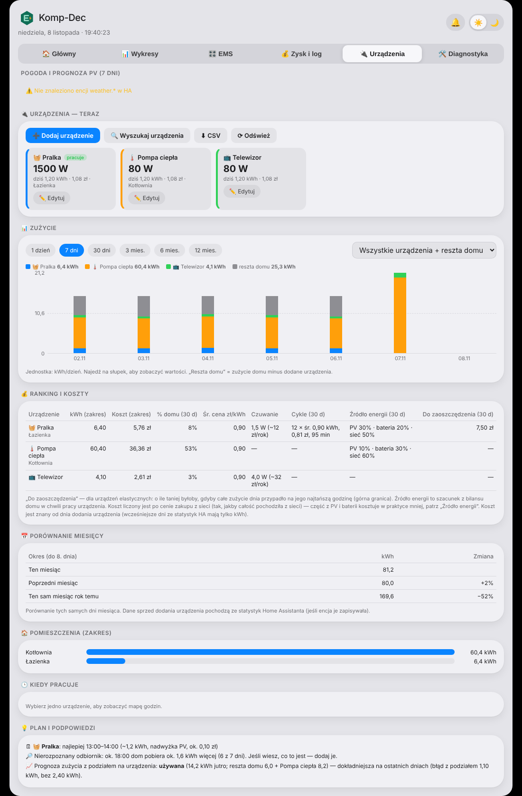

# EMS komp-dec

Integracja Home Assistanta, która pilnuje, kiedy falownik Deye ma ładować baterię z sieci, kiedy ją oddawać i kiedy blokować ładowanie z paneli. Plan na najbliższą dobę powstaje z cen prądu, prognozy produkcji z paneli i tego, ile dom zwykle zużywa. Do tego jest karta na pulpit: przepływ energii na żywo, plan, bilans w złotych, powiadomienia i dodatkowe urządzenia.

## Spis możliwości

- [Ekran główny](#ekran-główny)
- [Plan na dobę i harmonogram](#plan-na-dobę-i-harmonogram)
- [Prognoza produkcji z paneli](#prognoza-produkcji-z-paneli)
- [Prognoza zużycia](#prognoza-zużycia)
- [Ceny i taryfy](#ceny-i-taryfy)
- [Dzwonek: propozycje i powiadomienia](#dzwonek-propozycje-i-powiadomienia)
- [Rozliczenia, oszczędności i zdrowie baterii](#rozliczenia-oszczędności-i-zdrowie-baterii)
- [Dodatkowe urządzenia](#dodatkowe-urządzenia)
- [Zabezpieczenia](#zabezpieczenia)
- [Diagnostyka i autotest](#diagnostyka-i-autotest)

## Ekran główny

Na górze są bieżące ceny kupna i sprzedaży oraz prognoza pogody i produkcji paneli na 7 dni (z zakresem niepewności). Niżej przepływ energii na żywo (panele, dom, sieć, bateria), kafelka „Bateria” z informacją, kiedy będzie pełna albo kiedy dojdzie do progu odcięcia falownika, paski produkcji i zużycia oraz tabela „Sprzedaż i zakup energii” (dziś, miesiąc, razem) z szacunkiem, ile prądu kosztowałoby bez paneli i baterii.

Karta działa tak samo na telefonie, ma jasny i ciemny motyw.

## Plan na dobę i harmonogram

Plan na 24 godziny ładuje baterię z sieci w najtańszych godzinach, oddaje ją, gdy prąd jest drogi, i blokuje ładowanie z paneli, gdy opłaca się eksportować. Jeśli podasz cenę baterii i liczbę cykli, planer dolicza koszt jej zużycia i nie ładuje ani nie sprzedaje, gdy to się nie opłaca. Bierze pod uwagę próg odcięcia falownika, zapas na noc i bieżące zużycie domu.

W zakładce EMS widać wykres planu (SOC, ceny kupna i sprzedaży godzina po godzinie, ładowanie, sprzedaż, szczyt taryfy), zmiany, które plan zakłada w harmonogramie, i przełączniki sprzedaży, ładowania z sieci oraz blokady ładowania z paneli. „Inteligentny harmonogram” po kliknięciu „Zaproponuj” pokazuje każdą decyzję z uzasadnieniem.

Plan sprawdza też sprzedaż w oknach 3, 2 i 1 godziny, planuje mniejszą moc, gdy energii jest mało, i przy każdej zmianie decyzji zapisuje w dzienniku powód. Poprawnie przechodzi zmianę czasu (doby 23 h i 25 h).

## Prognoza produkcji z paneli

Źródłem jest Solcast albo Forecast.Solar. EMS rano zapisuje prognozę na 7 dni i po fakcie porównuje ją z wykonaniem, więc uczy się osobnej poprawki dla każdego dnia do przodu: dziś, jutro, za 2 dni i dalej. Do tego dochodzi stały wzorzec godzinowy (np. cień rano) i poprawka „na żywo” dla dzisiejszego dnia. Dni, w których falownik ucinał produkcję, bo bateria była pełna, nie uczą modelu.

Karta pokazuje prognozę po korekcie z zakresem i podpowiedzią z wartością surową. W „Zysk i log” → „Trafność prognoz” jest błąd osobno dla każdego dnia do przodu, także po korekcie, więc widać, czy korekta pomaga. Ustawienie „Ostrożność prognozy PV w planie” pozwala liczyć plan z wartością bliższą wersji pesymistycznej. Prognoza nigdy nie będzie idealna, bo błąd pogody rośnie z odległością dnia, a zakres na karcie to pokazuje. Pełna korekta pojawia się po kilkunastu dniach zbierania danych.

## Prognoza zużycia

Zużycie domu jest liczone z historii zbieranej od zera, osobno dla dni powszednich i weekendów, z poprawką na temperaturę i sezon. Pierwsza prognoza pojawia się po 5 pełnych dniach, profil godzinowy po 3. Podejrzane sumy dnia (np. powtórzony wynik z poprzedniej doby) są oznaczane i pomijane. Tabela „Ostatnie 14 dni” pokazuje rzeczywiste zużycie i prognozę.

## Ceny i taryfy

Obsługiwane są taryfy strefowe (np. G12w, z weekendami i świętami) oraz ceny dynamiczne godzinowe z RCE i Pstryka. Tabele cen sprzedaży i zakupu pokazują dziś i jutro, najtańsze i najdroższe godziny są zaznaczone kolorem. Ceny w planie są godzinowe.

## Dzwonek: propozycje i powiadomienia

W nagłówku karty jest dzwonek z licznikiem. Okno „Do decyzji” wyskakuje samo na środku ekranu, gdy przyjdzie nowe powiadomienie lub propozycja (można je też otworzyć dzwonkiem). Pokazywane są tylko propozycje, które coś zmieniają: każda ma znacznik ZMIENIAM, zmianę „było → będzie”, rozwijane „Dlaczego” i osobne przyciski **Potwierdź** i **Odrzuć**. Odrzuconą propozycję integracja zapamiętuje do czasu, aż plan zaproponuje inną godzinę, a auto-stosowanie jej nie wykona. Pod propozycjami jest skrzynka powiadomień: podsumowania, alarmy i informacje z ostatnich 14 dni.

Powiadomień jest ponad trzydzieści rodzajów (bateria, falownik, ceny i plan, działanie, urządzenia, podsumowania). Każdy włączasz osobno, wybierasz, czy trafia na telefon, jak często może przyjść, i czy może przyjść w ciszy nocnej. Są podsumowania dzienne, tygodniowe i miesięczne, w tym ile prądu kosztowałoby bez PV i baterii i skąd była energia dla domu. Jest też powiadomienie o oknie arbitrażu na jutro. Ustawienia są w Diagnostyce i działają także przy zamkniętej karcie.

## Rozliczenia, oszczędności i zdrowie baterii

Zakładka „Zysk i log” zawiera bilans w złotych (dziś, miesiąc, razem), porównanie kosztów: tak jak jest, bez baterii i z baterią bez planera, raport miesięczny z wykresem dni na plus i na minus, sprawność cyklu baterii, szacunek pojemności i trend sprawności z 7, 30 i 90 dni. Jest też dziennik decyzji planu i funkcje automatyczne (reakcja na niskie i ujemne ceny, dynamiczna rezerwa SOC, auto-stosowanie propozycji z możliwością cofnięcia).

## Dodatkowe urządzenia

Integracja potrafi sama znaleźć w Home Assistancie liczniki kWh (pralka, pompa ciepła, bojler) i pokazuje ich zużycie, koszty, ranking, porównanie miesięcy, zużycie według pomieszczeń i mapę godzin pracy. Wskazuje najlepszą godzinę dla urządzeń elastycznych i niezidentyfikowane odbiorniki. Wybrane urządzenia (np. bojler) EMS może sam włączać przy nadwyżce z paneli albo w najtańszych godzinach, jeśli na to pozwolisz.

## Zabezpieczenia

- Po instalacji zapis do falownika i automatyczne stosowanie planu są wyłączone. Przełącznik „Auto-stosowanie: tylko podgląd” pokazuje, co plan by zrobił, bez zapisu.
- Auto-stosowanie ma limit przesunięcia godzin, pilnuje spójności par START/STOP, nie rusza trwających operacji i można je cofnąć.
- Komendy są weryfikowane odczytem zwrotnym, a wartość, która zmieniła się po zapisie, wywołuje powiadomienie.
- Ochrona przyłącza (Deye): w zakładce EMS ustawiasz własny limit poboru z sieci (kW) i opcjonalnie sufit mocy ładowania z sieci. Gdy dom i ładowanie baterii go przekraczają, EMS zmniejsza prąd ładowania, a gdy jest zapas, przywraca go. Domyślnie wyłączone.
- Blokada sprzedaży z baterii, gdy chwilowy import z sieci albo import z całego dnia jest za duży.
- Tryby burzowy i urlopowy, reakcja na niskie i ujemne ceny, zabezpieczenie przed niskim SOC.
- Falowniki Sofar (G3 i hybrydowe) są obsługiwane eksperymentalnie: na start EMS tylko zapisuje w dzienniku, co by ustawił.

## Diagnostyka i autotest

Parametry falownika, strefy czasowe, alarmy, kopie ustawień, tryby i kreator instalacji są w Diagnostyce, za hasłem. Autotest sprawdza na żywo dane z falownika, prognozę, ceny i urządzenia i daje raport do skopiowania. Problemy, które trwają dłużej (brak danych z falownika, brak ceny, brak prognozy), pojawiają się też w Ustawienia, Naprawy.

Szczegółowa instrukcja obsługi z opisem każdej zakładki jest w pliku [Instrukcja_EMS_komp-dec.pdf](docs/Instrukcja_EMS_komp-dec.pdf).

## Czego potrzebujesz

Home Assistanta w wersji 2024.11 lub nowszej (tyle wpisałem w `hacs.json`, na starszych nie sprawdzałem) i hybrydowego falownika Deye z loggerem Solarman. Falowniki Sofar z magazynem (G3 i hybrydowe) są obsługiwane eksperymentalnie: na start EMS tylko zapisuje w dzienniku, co by ustawił, a zapis włączasz sam, gdy to sprawdzisz. Falownik możesz podłączyć przez integrację ha-solarman albo bezpośrednio do loggera, ale to drugie jest na razie eksperymentalne. Reszta jest opcjonalna: ceny z RCE lub Pstryka, prognoza PV i encja pogody.

## Instalacja

Przez HACS, jeśli repozytorium jest publiczne (HACS nie pobiera z prywatnych):

1. W HACS otwórz menu ⋮ i wybierz „Niestandardowe repozytoria”.
2. Wklej adres tego repozytorium i jako typ wybierz „Integracja”.
3. Znajdź „EMS komp-dec” i kliknij „Pobierz”.
4. Zrestartuj Home Assistanta.

Ręcznie, co działa także z prywatnego repozytorium:

1. W zakładce Releases pobierz `bms_komp_dec.zip` z najnowszego wydania.
2. Rozpakuj go do `/config/custom_components/bms_komp_dec/`. W archiwum od razu są pliki integracji, bez dodatkowego folderu.
3. Zrestartuj Home Assistanta.

## Pierwsze uruchomienie

1. Wejdź w Ustawienia, Urządzenia i usługi, Dodaj integrację i wybierz „EMS komp-dec”.
2. Wybierz „Kreator: falownik + planer w jednym”. Doda falownik (albo użyje tego z ha-solarman), poczeka na pierwsze odczyty i dopasuje encje. Przez pierwsze kilkadziesiąt sekund falownik może jeszcze nie odpowiadać, to normalne.
3. Po instalacji zapis do falownika i automatyczne stosowanie planu są wyłączone. Włączasz je sam, kiedy będziesz gotowy. Przełącznik „Auto-stosowanie: tylko podgląd” pokazuje, co plan by zrobił, bez zapisu do falownika.
4. Dodaj kartę na pulpit: tryb edycji, „Dodaj kartę”, „Centrum Energii” (typ `custom:bms-panel-card`). Zasób z kodem karty integracja dodaje sama.

## Aktualizacja

W HACS pojawi się powiadomienie o nowej wersji. Ręcznie zrób kopię zapasową, usuń stary folder `bms_komp_dec`, rozpakuj nową wersję i zrestartuj Home Assistanta. Potem odśwież przeglądarkę (Ctrl+F5, w aplikacji na telefonie wyczyść pamięć podręczną), żeby nie została stara karta.

Co się zmieniło w kolejnych wersjach, jest w [CHANGELOG.md](CHANGELOG.md).

## Gdy coś nie działa

Uruchom autotest w Diagnostyce i skopiuj raport. Możesz też pobrać plik diagnostyczny: Ustawienia, Urządzenia i usługi, EMS komp-dec, menu ⋮, „Pobierz diagnostykę”. Adres i numer seryjny falownika oraz usługa powiadomień są w nim ukryte.

## Uwaga

Integracja steruje falownikiem i magazynem energii. Używasz jej na własną odpowiedzialność, więcej w pliku [LICENSE](LICENSE). Na początek zostaw zapis do falownika wyłączony i zobacz, co proponuje plan.

## Licencja

Wszelkie prawa zastrzeżone. Możesz zainstalować integrację u siebie do użytku osobistego, ale bez zgody autora nie wolno jej kopiować, przerabiać na dalsze udostępnianie ani używać komercyjnie.

Kod w `custom_components/bms_komp_dec/direct/` pochodzi z projektów ha-solarman i pysolarman (MIT) oraz umodbus (MPL-2.0) i ma własne licencje, które leżą obok w plikach `LICENSE-*.txt`. Biblioteki Chart.js 4.4.1 i chartjs-adapter-date-fns 3.0.0 (MIT) są dołączone w `frontend/vendor/`, dzięki czemu wykresy działają bez dostępu przeglądarki do internetu.
